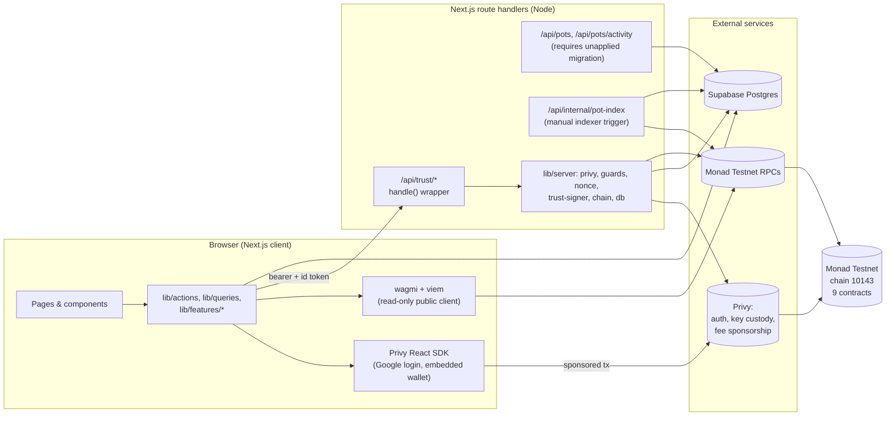
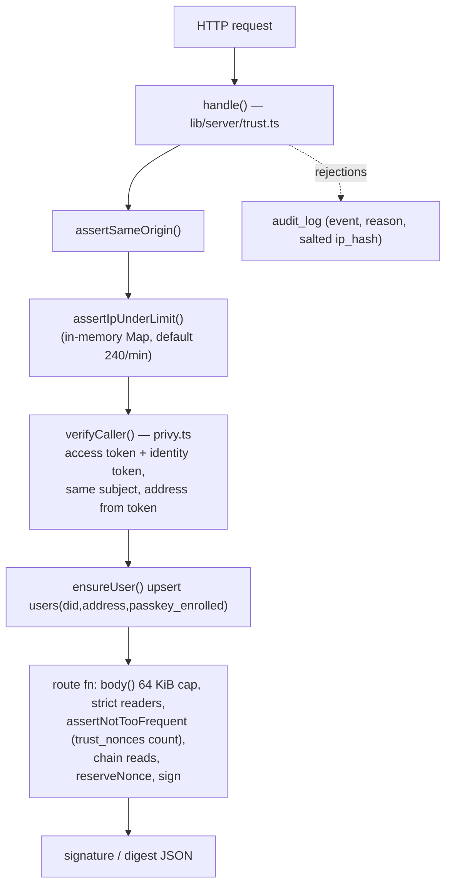
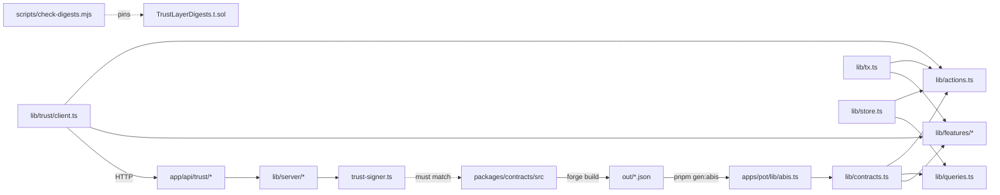

# ARCHITECTURE

Part of the [PROJECT_DOSSIER](PROJECT_DOSSIER.md). Describes what exists in the
repository on 2026-10-12, read from source. Contract detail is in
[CONTRACTS.md](CONTRACTS.md), endpoint detail in [API_REFERENCE.md](API_REFERENCE.md),
security in [SECURITY.md](SECURITY.md).

**Working-tree caveat.** The repository's last commit (`602fc49`) does not
contain the current app. Most of `apps/pot/app/(app)/**`, `components/feature/**`,
`lib/features/**` and several routes are *untracked*, and some files tracked at
HEAD are deleted in the working tree (`git status` on 2026-10-12: 45 untracked,
37 modified, 6 deleted entries outside `.playwright-mcp`). Everything below
describes the **working tree**, not HEAD.

## 1. Technology stack

| Layer | Technology | Evidence (declared → installed) |
|---|---|---|
| Monorepo | pnpm workspace (`apps/*`, `packages/*`), `packageManager pnpm@12.10.1`, `engines.node >=20` | `package.json`, `pnpm-workspace.yaml`; Node v26.1.0 and pnpm 12.10.1 present locally |
| Contracts | Solidity 0.8.24, Foundry, OpenZeppelin 5.7.0, forge-std 1.17.0 | `packages/contracts/foundry.toml`, `foundry.lock` |
| App framework | Next.js 16.4.0 (App Router, `cacheComponents: true`, `partialPrefetching: true`, Turbopack with workspace root two levels up), React 19.3.0, TypeScript ^5 (5.9.3 installed) | `apps/pot/package.json`, `next.config.ts` |
| Styling / UI | Tailwind CSS 4 (CSS-first, no `tailwind.config`), shadcn/ui style `base-nova` on `@base-ui/react ^1.9`, `lucide-react`, `motion ^14`, `sonner`, `next-themes`, `tw-animate-css` | `components.json`, `app/globals.css` |
| Auth / wallet | Privy: `@privy-io/react-auth ^3.48` (client), `@privy-io/node ^0.35` (server token verification), `@privy-io/wagmi ^4` | `package.json`, `lib/server/privy.ts` |
| Chain client | `wagmi ^3.7`, `viem ^2.56.5`, chain `monadTestnet` (id 10143) from `viem/chains` | `lib/contracts.ts`, `lib/wagmi.ts` |
| Data fetching | `@tanstack/react-query ^5.104` (staleTime 4 s, refetch on focus) | `app/providers.tsx` |
| Database | Supabase (Postgres 17, project `pot-socialpay`, region ap-south-1) via `@supabase/supabase-js ^2.117` | live `list_projects` on 2026-10-12 |
| Validation | `zod ^4.6.5` for env; hand-written strict readers for request bodies | `lib/env.ts`, `lib/server/route-kit.ts` |
| Tests | Vitest ^5 (node environment, `lib/**/*.test.ts`), Foundry tests | `vitest.config.mts`, `packages/contracts/test` |
| Hosting | **Not deployed.** Vercel is the intended target; no `.vercel` link exists locally | `HANDOFF.md`, `docs/production-readiness.md` |

Planned but absent packages (README "Structure"): `apps/trust` (Expo),
`packages/verification`, `packages/shared-ui` — **not built**.

## 2. Repository map

```
pot/
├─ CLAUDE.md                original product brief (kept verbatim; partly superseded)
├─ README.md                setup guide + status table (some figures stale)
├─ HANDOFF.md, STATUS.md    session logs
├─ PROJECT_DOSSIER.md …     this documentation package
├─ docs/                    context, tech, limitations, trust-layer, security-audit,
│                           production-readiness, insurer-api, questionnaire, user-testing…
├─ supabase/
│  ├─ schema.sql            pots, profiles, memos (+ open RLS policies)
│  └─ migrations/           5 files (see §6); the live DB also has 5 migrations
│                           that exist only in Supabase (see §6)
├─ packages/contracts/      Foundry project (src, test, script, broadcast)
└─ apps/pot/                the Next.js app
   ├─ app/
   │  ├─ layout.tsx, globals.css, providers.tsx
   │  ├─ (app)/             every user-facing page, wrapped in <Providers>
   │  └─ api/               route handlers (trust/*, pots/*, internal/pot-index)
   ├─ components/           ui/ (shadcn primitives), feature/ (shared feature kit),
   │                        pot/ (pot-specific), plus shell, login, nav
   ├─ lib/                  contracts, abis (generated), tx, actions, queries, store,
   │                        features/ (one module per feature), server/ (server-only),
   │                        trust/ (browser client of the trust API), nav/, money, time…
   ├─ scripts/              gen-abis.mjs, check-digests.mjs, flow-check.mjs
   ├─ instrumentation.ts    imports lib/env at server start (fail fast)
   └─ DEPLOY.md, AGENTS.md, .env.example
```

Stray/legacy items (documented, not part of the product): root `app/README.md`
(an old "kivo" scaffold readme, untracked), `files (2).zip` (tracked),
`pre-monorepo-snapshot.zip` (ignored), `.dist/` (141 MB quarantined copy, ignored),
`.playwright-mcp/` (7 files tracked, more untracked), `.remember/`, `.backup/`
(empty), `.claude/`.

## 3. System context



Key design points (all verified in source):

- **The user's wallet sends transactions**, never the server, with two
  exceptions: `IncomeShare.recordRepayment` (server wallet, `lib/server/chain.ts`)
  and — not implemented — `MicroCover.activatePolicy`.
- **Reads go straight to the chain** through a wagmi public client with a
  five-endpoint fallback transport.
- **Offchain text** (pot names, display names, memo text) lives in Supabase with
  an on-device `localStorage` fallback (`lib/store.ts`). Only hashes reach the
  chain.
- **The trust layer** is a set of server routes that check something the chain
  cannot (an invite code, a typed number) and return an ECDSA signature the
  contract verifies.

## 4. Frontend architecture

### 4.1 Provider tree and routing

- `app/layout.tsx` (server): fonts (Inter 400/500/600/700 via `next/font`),
  `<Toaster position="top-center" theme="light">`, imports `@/lib/env` for its
  side effect (config validation).
- `app/(app)/layout.tsx`: wraps every user page in `<Providers>`
  (`PrivyProvider` → `QueryClientProvider` → `WagmiProvider` from `@privy-io/wagmi`).
  A previous `/preview` gallery route group was deleted in the working tree.
- Privy config: `loginMethods: ["google"]`, embedded Ethereum wallet created on
  login for users without one, `showWalletUIs: false` (no confirmation modals),
  `defaultChain`/`supportedChains` = Monad Testnet, light theme, accent `#4f46e5`.
- `app/(app)/[...slug]/page.tsx` is a catch-all that replaces Next's 404 with a
  "not ready / nothing here" frame; unbuilt features named in `lib/nav/routes.ts`
  get their own name back.
- Every page is wrapped in `AppShell` (a `max-w-md` single column, sticky header,
  `StickyBar` for the primary action) and, where a signed-in wallet is required,
  `LoginGate`.

### 4.2 State management

There is no global store. State is (a) React Query caches keyed by feature
(`["my-pots", address]`, `["pot", id, address]`, `["pot-activity", id, address]`,
`["test-money", address]`, plus per-feature keys), (b) component `useState` for
forms, (c) `localStorage` for offchain-text fallback (`pot:meta:<id>`,
`pot:name:<addr>`, `pot:memo:<hash>`), and (d) the chain as the source of truth.
Mutations invalidate queries (`useRefresh` in `lib/actions.ts`).

### 4.3 Write path (`lib/tx.ts`)

`useSponsoredCall()` encodes the call with viem, sends it through Privy
`useSendTransaction` with `{ sponsor: true, address }` (Privy native gas
sponsorship; no smart account), then waits up to 90 s for the receipt and throws
unless `status === "success"`. A sponsorship-unavailable error is mapped to a
neutral message and **never retried without sponsorship**. `readableError()` maps
named contract errors to plain English (some errors are unmapped — see the issue
register in the dossier). Amounts are `bigint` paise on the wire; `lib/money.ts`
converts to/from rupee strings (regex-validated, max 2 decimals, `en-IN` grouping).

`useAddMoney` (and the equivalent create/deposit hooks in each feature) sends
`approve(spender, maxUint256)` first when the allowance is short, then the
action, presented as one step.

### 4.4 Read path

`lib/queries.ts` (Pot), `lib/token.ts` (per-spender allowance + balance),
`lib/features/*.ts` (one module per feature) use `usePublicClient()` multicalls.
List screens enumerate ids `0..count-1` (or `1..count`) and filter in the
browser — see "Scaling" below. The comment blocks in several modules state that
Monad's public RPC rejects `eth_getLogs` ranges wider than 100 blocks (HTTP 413,
code -32614); client code therefore contains **no `getLogs` calls** (verified by
search); only the server-side indexer scans logs.

### 4.5 Pot discovery and activity — two implementations

| | A. Indexed (as of HEAD / documented) | B. Direct on-chain (current working tree) |
|---|---|---|
| `useMyPots` | `GET /api/pots` → reads `pot_activity_sync` + `pot_activity_members`, rechecks `isMember` at the finalized block | reads `potCount`, multicalls `isMember(id, me)` for the newest ≤200 ids, then `getPot` |
| `usePotActivity` | `GET /api/pots/activity` pages of finalized events with real timestamps | `deriveStateFeed()` rebuilds a feed from `getPot/getMembers/contributed/refundClaimed/getSpend` — no timestamps, one total per depositor, no approver identity |
| Requires | **Applied migration `20261012_pot_activity_index.sql` and a running indexer** (neither exists on the live DB) | Nothing beyond RPC |
| Status | Implemented, unit-tested pieces only; **not deployed, never run** | Implemented, `tsc` clean, **not otherwise verified**; contains the spend-id defect K-01 (see dossier) |

Implementation B was made during this session at the user's instruction and has
not been reviewed or run. Documents written earlier (`DEPLOY.md`, `docs/tech.md`,
`production-readiness.md`) still describe A and say the client "requires the
unapplied server index"; they are therefore **stale for the working tree**.
Routes `/api/pots`, `/api/pots/activity` and `/api/internal/pot-index` still
exist but nothing in the client calls the first two under B.

### 4.6 Scaling characteristics (code-read, not measured)

- Pot discovery B: one `isMember` read per candidate pot (≤200) per 30 s
  refresh per open Home screen.
- Gifts, pay, savings, pools, streams, cover list screens multicall `getX(id)`
  for **every id ever created** each refresh (e.g. `gift.ts` lines ~140–165).
  Cost grows with global usage.
- Public RPC rate limits: `lib/wagmi.ts` comments claim concurrent-read failures
  above ~30 requests (HTTP 429) from one address; this is an authors' note, not a
  checked-in benchmark. The documented "60 concurrent readers" claim was withdrawn.

## 5. Backend architecture

All server code is under `apps/pot/lib/server` and `apps/pot/app/api`, imported
with `import "server-only"`.



- `lib/server/env.ts` — fail-closed getters (`required()`); `TRUST_SIGNER_KEY()`
  throws unless `TRUST_SIGNER_ENABLED=true` and the key's address is **not** the
  compromised legacy signer `0xbe4ad8cc…1d94`.
- `lib/server/db.ts` — Supabase service-role client (`SUPABASE_SECRET_KEY`).
- `lib/server/chain.ts` — `reader()` public client; `giftConditionHash`,
  `claimFacts` reads; `submitRepayment` is the one server-sent write.
- `lib/server/trust-signer.ts` — every digest the server may sign
  (`joinDigest`, `behaviourDigest`, `conditionDigest`, `settlementDigest`,
  `poolAttestationDigest`, `employerDigest`) and the matching `sign*` functions;
  `repaymentDigest` is computed but never signed server-side (the recipient signs).
- `lib/server/nonce.ts` — `reserveNonce` (insert before signing), `consumeNonce`
  (conditional update), `assertNotTooFrequent` (counts `trust_nonces` per DID per
  action per hour; fails closed).
- `lib/server/guards.ts`, `logging.ts` (logs only error name/SQLSTATE-like code),
  `indexer-auth.ts` (timing-safe bearer compare), `pot-indexer.ts` (finalized-block
  scanner with lease and checkpoint).
- Dead/legacy: `lib/server/signer.ts` is a re-export shim; `PRIVY_APP_SECRET()`
  and `ARBITRATOR_ADDRESS()` are defined but never called.

### Pot indexer (implementation A)

`indexPotActivity()` (called by `POST /api/internal/pot-index`, bearer
`POT_INDEXER_SECRET`): gets the `finalized` block, acquires a 110 s lease through
RPC `claim_pot_activity_lease`, loads/creates the `pot_activity_sync` checkpoint
(start = `NEXT_PUBLIC_DEPLOY_BLOCK`), verifies the stored block hash still matches
(else aborts "reconcile before continuing"), then scans up to 20 ranges of 100
blocks per run, decodes `PotManager` events, fetches block timestamps in batches
of 10, upserts events (`ignoreDuplicates`, key
`(chain_id, contract_address, transaction_hash, log_index)`) and member rows, and
advances the checkpoint after each range. **No scheduler exists** in the repo
(no `vercel.json`, no cron). Starting at block 69,937,293 against a head of
~70.39 M implies on the order of 4,500 ranges (≈225 runs of 20 ranges) to catch
up — an arithmetic estimate from the numbers above, not a measurement.

## 6. Database

Live project `fcunndkhimsngmjjczoy` (`pot-socialpay`), inspected read-only on
2026-10-12. RLS is enabled on all 33 public tables.

| Group | Tables (rows on 2026-10-12) | Purpose / notes |
|---|---|---|
| Pot offchain text | `pots` (2), `profiles` (1), `memos` (0), `pots_private` (**0**) | Names, display names, memo text; invite codes in `pots_private`. Policies on `pots`, `pots_private` read back from `pg_policies`: `pots` has public SELECT/INSERT/UPDATE `true`; `pots_private` has public INSERT `true` and a SELECT policy `creator_did = current_did()` that anon cannot satisfy. |
| Trust layer core | `users` (0), `trust_nonces` (0), `audit_log` (1), `send_limits` (1), `behaviour_signals`, `income_declarations`, `gift_conditions`, `oracle_events`, `employer_attestations` (all 0) | Nonce ledger, rate-limit substrate, audit trail, typed-number records |
| SocialPay trust (unused by app) | `payments`, `contacts` | Defined, no app caller |
| Employer / stream (unused) | `employers`, `employer_checks`, `employer_employees`, `stream_policy` (1), `stream_solvency` | Defined, only `verify-employer` writes `employer_attestations` |
| Income-share (partially used) | `aa_consents`, `isa_agreements`, `isa_signatures`, `income_assessments`, `isa_repayments`; `income_declarations` | Only `income_declarations` is written (by `attest-income`) |
| Micro-insurance (unused except `oracle_events`) | `insurers`, `cover_products`, `policies`, `exposure_declarations`, `claims`, `claim_evidence`, `claim_decisions`, `premium_settlements` | Specified in `docs/insurer-api.md`; `sellable` gated on an IRDAI filing reference by constraint (per docs) |
| Pot activity index | `pot_activity_events`, `pot_activity_members`, `pot_activity_sync`, `pot_activity_leases` | **Do not exist on the live DB** — migration `20261012_pot_activity_index.sql` is unapplied |

Migration files in the repo: `20261010_trust_layer_core.sql`,
`20261010_split_invite_codes.sql`, `20261010_micro_insurance_trust_layer.sql`,
`20261011_redact_raw_ips.sql`, `20261012_pot_activity_index.sql`. Live DB
migration history (`list_migrations`): `socialpay_trust_layer`,
`pot_offchain_text`, `lock_down_trigger_function`, `employer_trust_layer`,
`isa_trust_layer`, `micro_insurance_trust_layer`, `split_invite_codes`,
`trust_layer_core`, `redact_raw_ips`. The first five exist **only** in Supabase
(the repo cannot rebuild the database from source — Contradiction/gap G-2).

`send_limits`: single row; `daily_total_paise` 1,000,000 (₹10,000), step-up
threshold 100,000 (₹1,000) per table comments. These limits and the SocialPay
tables are not used by any current route (no payments route exists).

### What breaks if migrations/indexer are absent

- With implementation B (working tree): nothing in Home/Pot detail depends on
  the activity tables.
- With implementation A: `GET /api/pots` returns 503 `pot_index_not_ready` for
  every user (no `pot_activity_sync` row), so Home shows an error; the pot feed
  fails likewise. This is the live DB's current state.

## 7. Environment variables

Names from `apps/pot/.env.example` and code. Values are never recorded here.
"Local" is the state of `apps/pot/.env.local` on 2026-10-12 (set/blank only).

| Variable | Public? | Used in | Needs dashboard access? | Local |
|---|---|---|---|---|
| `NEXT_PUBLIC_PRIVY_APP_ID` | public | `lib/env.ts`, `providers.tsx`, server `privy.ts` | Privy dashboard | set |
| `PRIVY_APP_SECRET` | **secret** | `lib/server/env.ts` getter (never called) | Privy dashboard | set |
| `PRIVY_VERIFICATION_KEY` | secret-ish (public key PEM) | `lib/server/privy.ts` | Privy dashboard | set |
| `TRUST_SIGNER_ENABLED` | server | `lib/env.ts`, `lib/server/env.ts` | no | **absent** (→ disabled) |
| `TRUST_SIGNER_KEY` | **secret (compromised)** | `lib/server/env.ts` | no | set |
| `POT_INDEXER_SECRET` | **secret** | `app/api/internal/pot-index` | no | absent |
| `IP_HASH_SALT` | **secret** | `lib/server/guards.ts` | no | set |
| `TRUST_IP_MAX_PER_MINUTE` | server | `guards.ts` (default 240) | no | absent |
| `NEXT_PUBLIC_APP_URL` | public | `lib/env.ts` → origin guard | Vercel | **blank** |
| `NEXT_PUBLIC_{TEST_RUPEE,POT_MANAGER,SOCIAL_PAY,GIFT,BEHAVIOUR_SAVINGS,SALARY_STREAM,INCOME_SHARE,MICRO_COVER,ACCOUNTABILITY_POOL}_ADDRESS` | public | `lib/contracts.ts` (must be written out literally for Next inlining) | no | set |
| `NEXT_PUBLIC_DEPLOY_BLOCK` | public | `lib/contracts.ts` (`DEPLOY_BLOCK`) → indexer start | no | set |
| `NEXT_PUBLIC_ARBITRATOR_ADDRESS` | public | server getter only (never called) | no | set |
| `NEXT_PUBLIC_SUPABASE_URL`, `NEXT_PUBLIC_SUPABASE_ANON_KEY` | public | `lib/env.ts`, `lib/store.ts`, server `db.ts` (URL) | Supabase | set |
| `SUPABASE_SECRET_KEY` | **secret** (bypasses RLS) | `lib/server/db.ts` | Supabase | set |
| `NEXT_PUBLIC_RPC_URL` | public | `wagmi.ts` (first in fallback), server `chain.ts`, indexer | provider | absent |
| `NEXT_DIST_DIR` | build | `next.config.ts` (used for isolated validation builds) | no | n/a |
| `DEPLOYER_KEY` (`packages/contracts/.env`) | **secret (compromised)** | `script/Deploy.s.sol` via env; **also read by `apps/pot/scripts/flow-check.mjs`** | no | set |

Validation: `lib/env.ts` requires the three public Privy/Supabase values at
import time (throws in production, warns in `NODE_ENV=development`), validates
the signer key format only when `TRUST_SIGNER_ENABLED=true`, and skips both
during `next build` (`NEXT_PHASE`). `instrumentation.ts` re-runs it at server
start.

## 8. Install, build, test, run (clean checkout)

Prerequisites: Node ≥ 20, pnpm 12, Foundry (to build/test contracts). Accounts
needed only for a real run: Privy app, Supabase project, funded Monad Testnet key.

```bash
git clone <repo> && cd pot
pnpm install                                   # note: ERR_PNPM_IGNORED_BUILDS has been reported; builds still pass

# contracts (needs Foundry: https://getfoundry.sh)
cd packages/contracts
forge install foundry-rs/forge-std OpenZeppelin/openzeppelin-contracts
forge build && forge test                      # last recorded: 408 pass (not rerun here)

# regenerate app ABIs after any contract change
cd ../../apps/pot && pnpm gen:abis

# app
cp .env.example .env.local                     # fill in; see §7 and DEPLOY.md
pnpm dev                                       # http://localhost:3000
pnpm typecheck && pnpm lint && pnpm test       # tsc, eslint, vitest (77 tests)
pnpm build                                     # production build
```

Safe for local development without any accounts: unit tests (`pnpm test`),
`pnpm typecheck`, `pnpm lint`, and `pnpm dev` (screens degrade to "not set up"
notices; sign-in needs a Privy app id). Requires dashboard access: Privy
(login method Google, "Return user data in an identity token" ON, fee sponsorship
for chain 10143, allowed domains/OAuth redirects), Supabase (run `schema.sql` then
every migration), Vercel (env vars; `NEXT_PUBLIC_*` are inlined at build time so
must be set for the production build).

## 9. Deployment

Intended: Vercel, root directory `apps/pot`, env vars from §7 for Production and
Preview (`DEPLOY.md`). **Not performed**: no Vercel link, no deployed URL, no
cron/scheduler, no monitoring or analytics configuration, no staging/production
split (Unknown/absent — see dossier §9).

## 10. Dependency map



The TypeScript/Solidity digest agreement is guarded by
`scripts/check-digests.mjs` (prints TS digests for fixed inputs) and
`packages/contracts/test/TrustLayerDigests.t.sol` (asserts the same bytes).
Whether the two were last run together is Unknown for this pass.

## 11. Architectural risks recorded (see SECURITY.md and the dossier register)

1. Two parallel pot-history designs, only one of which is runnable without
   external setup; docs describe the other.
2. Trust-signer address is baked into five contracts and is compromised.
3. Display text tables are writable by anyone with the public anon key.
4. O(N) list scans across features.
5. In-memory IP throttle is per-instance on serverless.
6. The repo cannot rebuild the production database from its own migrations.
